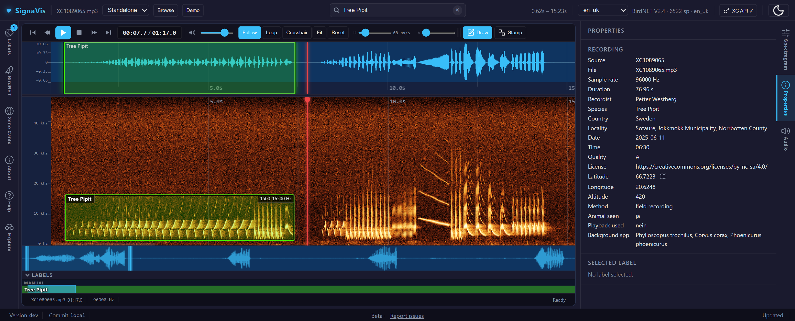

# SignaVis

<p align="center">
  
</p>

<div align="center">
<table align="center" cellpadding="12" cellspacing="0" style="border:1px solid #e1e4e8;background:#f6f8fa;border-radius:6px;">
  <tr>
    <td align="center">
      <h3>💡 Try it — Demo</h3>
      <p>Interactive demo and a full labeling app (BirdNET detection &amp; annotation). Try them in your browser:</p>
      <p>
        <a href="https://limitlessgreen.github.io/SignaVis/"></a>
        <a href="https://limitlessgreen.github.io/SignaVis/demo/labeling-app.html?xcid=1"></a>
      </p>
      <p>
        <a href="https://github.com/LimitlessGreen/SignaVis/actions/workflows/ci.yml"></a>
        <a href="https://www.npmjs.com/package/signavis"></a>
        <a href="https://pypi.org/project/signavis/"></a>
        <a href="https://github.com/LimitlessGreen/SignaVis/blob/main/LICENSE"></a>
        <a href="https://zenodo.org/badge/latestdoi/1161163939"></a>
      </p>
    </td>
  </tr>
</table>
</div>

DAW-like audio player (waveform + spectrogram + transport controls) as a standalone library — built for bioacoustic analysis, annotation, and embedding.

## Table of contents

- [Highlights](#-highlights)
- [Labeling app](#labeling-app)
- [Install](#install)
- [Quickstart](#quickstart)
- [Documentation](#documentation)
- [Demos](#demos)
- [Python wrapper](#python-wrapper)
- [Development](#development)
- [Contributing](#contributing)
- [Citation](#citation)
- [License](#license)

## ✨ Highlights

- **Fast, accurate spectrograms** — computed in Rust/WebAssembly and rendered on the GPU; presets, colour schemes, auto contrast, PCEN, log frequency
- **Synced waveform + spectrogram** with smooth zoom, scroll and playhead follow — also for long recordings
- **Label annotation** — draw, move, resize, undo/redo; *snap to call* boxes a call from a single click; zoom box and edit loupe for precise edges
- **BirdNET suggestions** — accept or discard detections in one click
- **Xeno-canto integration** — import recordings and their annotation sets, compare with reference calls, upload your labels as Annota-JSON sets
- **Projects** — stored in the browser or in a local folder (File System Access API), Raven export
- **Bat recordings** — time expansion, heterodyne, frequency division and pitch shift
- **Embeddable** — npm package (ESM / IIFE) and a Python wrapper for Jupyter, Streamlit and Gradio

## Labeling app

The [labeling app](https://limitlessgreen.github.io/SignaVis/demo/labeling-app.html?xcid=1) runs entirely in the browser — no install, no server.

| | |
|---|---|
| **Overview** — load a recording, zoom and play<br> | **Labeling** — draw and name labels<br> |
| **Snap to call** — one click boxes the call<br> | **Zoom box & loupe** — precise box edges<br> |
| **Display** — presets, colour schemes, contrast<br> | |

**SignaVis Lite** — the same app as a small desktop program for Windows, macOS and Linux (project folders, offline use, self-update). [Download the latest release](https://github.com/LimitlessGreen/SignaVis/releases/latest) · [install notes](docs/signavis-lite.md) (the installers are not code-signed yet).

## Install

```bash
npm i signavis
```

Note: signavis expects `wavesurfer.js` as a peer dependency (v7). Install it with:

```bash
npm i wavesurfer.js@^7
```

Or include `wavesurfer.js` from a CDN in the browser:

```html
<script src="https://unpkg.com/wavesurfer.js@7"></script>
```

Or for Python:

```bash
pip install signavis
```

See [PyPI](https://pypi.org/project/signavis) and the [python-wrapper/README.md](python-wrapper/README.md) for full Python usage.

## Quickstart
```js
import { BirdNETPlayer } from 'signavis'
import 'signavis/style'

const player = new BirdNETPlayer(document.getElementById('player'))
await player.ready
```

## Documentation

Full documentation lives on the [docs site](https://limitlessgreen.github.io/SignaVis/docs/):

- [Player Options](https://limitlessgreen.github.io/SignaVis/docs/usage/player-options/) — all constructor options
- [Integration Examples](https://limitlessgreen.github.io/SignaVis/docs/usage/integration/) — ESM, React, Vue, Svelte, CDN/IIFE, Streamlit, Jupyter
- [Labeling App](https://limitlessgreen.github.io/SignaVis/docs/labeling/) — shortcuts, species format, Xeno-canto format
- [Python Integration](https://limitlessgreen.github.io/SignaVis/docs/labeling/python-integration/)
- [Deployment & Migration](https://limitlessgreen.github.io/SignaVis/docs/deployment/)

## Demos

- **[Live Demo (GitHub Pages)](https://limitlessgreen.github.io/SignaVis/)** — component storybook with configurable stories
- **[Labeling App](https://limitlessgreen.github.io/SignaVis/demo/labeling-app.html?xcid=1)** — full-featured annotation tool with BirdNET detection, Xeno-canto integration, label management and spectrogram settings (`demo/labeling-app.html`)
- **[Google Colab Demo Notebook](https://colab.research.google.com/github/LimitlessGreen/SignaVis/blob/main/python-wrapper/demo_colab.ipynb) [](https://colab.research.google.com/github/LimitlessGreen/SignaVis/blob/main/python-wrapper/demo_colab.ipynb)**
- **Streamlit:** `streamlit run python-wrapper/demo_streamlit.py`
- **Gradio:** `pip install gradio && python python-wrapper/demo_gradio.py`

## Python wrapper

The Python wrapper allows embedding the player in Streamlit, Jupyter, and Gradio.

```bash
pip install signavis
```

See [python-wrapper/README.md](python-wrapper/README.md) for full usage, options, and advanced features, and
[PyPI](https://pypi.org/project/signavis) for the published package.

## Development

```bash
npm ci
npm run dev          # Vite dev server, labeling app at /demo/labeling-app.html
npm run typecheck
npm test
npm run build        # library + types into dist/ and types/
```

See [DEVELOPER.md](DEVELOPER.md) for the full setup, git hooks, release and desktop (Tauri) build instructions.

## Contributing

See [CONTRIBUTING.md](CONTRIBUTING.md). Issues and PRs welcome on
[GitHub](https://github.com/LimitlessGreen/SignaVis).

## Citation

If you use SignaVis in your research, please cite it — see [CITATION.cff](CITATION.cff) for machine-readable
metadata (also shown via the "Cite this repository" button on GitHub), or use:

```bibtex
@software{signavis,
  author  = {Behrisch, Jairus},
  title   = {SignaVis: Interactive waveform + spectrogram audio player for bioacoustic analysis and annotation},
  url     = {https://github.com/LimitlessGreen/SignaVis},
  license = {AGPL-3.0-only}
}
```

A DOI via [Zenodo](https://zenodo.org/) is minted automatically for each GitHub release; see the DOI badge at
the top of this README for the latest version.

## License

GNU AGPL-3.0
